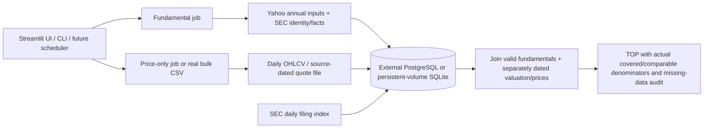

# Storage / freshness architecture review — PR #2

## Physical persistence: current fact versus deployment requirement
Development uses `/workspace/market-discovery/.cache/discovery.sqlite3`. This is a local file, not an external production database. A process restart retaining that file preserves snapshots, traversal, budgets and leases. Deleting/rebuilding an ephemeral filesystem does not. No production hosting identity, persistent mount or external DB URL was provided in this task, so production restart/redeploy persistence is **not verified**.

Production options:
1. Configure `DISCOVERY_DATABASE_URL` in server environment / Streamlit secrets for PostgreSQL outside the app's filesystem. Tables live on the host/database named by that secret, in the provider region selected by the operator. The repository has no actual production host/region to report. Same secret/database after redeploy reuses the records. DB retention/backups remain provider/operator responsibilities. A configured connection failure fails closed, without local fallback.
2. On a host with persistent volumes, mount one and set `DISCOVERY_CACHE_PATH=/persistent-volume/discovery.sqlite3`. This is a deployment mount, not a guarantee inferred from a relative `.cache` path.

For Streamlit Community Cloud or any ephemeral hosting, do not call local SQLite a redeploy-safe production store. When moving an existing SQLite deployment, stop all workers, back up the file, set target `DISCOVERY_DATABASE_URL` as an environment secret and run `python migrate_storage.py /path/source.sqlite3` for a dry run, then the same command with `--apply` to an EMPTY target. The migration copies snapshots/cache/campaigns/results/budgets transactionally, resets in-flight leases to pending and restores PostgreSQL campaign sequences. It refuses nonempty targets; switching a secret alone does not migrate old data. Keep the original backup and check counters before reopening workers.

Never put the real PostgreSQL URL/password in GitHub. The tracked secret file is a placeholder only. Remote credentials were neither requested in chat nor provisioned/printed.

## Dates and validity
Financial period end, SEC filed/publication date (unknown=N/A), fundamental retrieval timestamp, price source timestamp and price retrieval timestamp are distinct. SEC filed date is not automatically the earnings-announcement date. Expected results are estimates, not confirmed publication. Technical summaries also retain their own bar date and retrieval timestamp; an earlier daily-bar timestamp can update technicals without rewinding a newer quote. A raw daily bar index is labeled as a source-price date, not an invented exact closing-trade timestamp.

Fundamentals persist without TTL deletion. Default validity is original retrieval +90 days, capped at expected results +2 days; known new 10-K/10-Q filing invalidates them, as does an observed later stock split affecting EPS units. Annual inputs still require a nonfuture period no older than 550 days. A failed refresh keeps original data and timestamps, with an error; it does not extend validity. Older periods cannot replace newer successful data. Legacy records missing publication/CIK rely on the fallback policy until a real refresh supplies metadata.

Prices refresh independently. Recent technical snapshots can be reused for 12h; usable source price and valuation timestamps must be <=7 days old. Forward P/E is recomputed only from real provider forward EPS and a compatible quote currency; otherwise only a still-recent original provider P/E can be used. Unknown EPS/FX/ADR conversions remain N/A. Estimated EPS itself is as-of the fundamental snapshot, not a newly obtained consensus. The method remains an annual screening model, not a synchronized quarterly/TTM accounting dataset.

The daily filing index is a bulk event hint: one completed-day file can identify relevant CIKs without per-company HTTP checks. Real index observation exposed SEC's `File Name` header and compact `YYYYMMDD` dates; parser/tests were corrected. Failed/malformed index requests are explicit errors with a retry backoff, not successful empty coverage. The implementation checks the latest completed business day; missed-day backfill, 8-K/6-K earnings releases and an always-on scheduler are not implemented. No event guarantee is claimed when the source is unavailable, a day was missed or CIK/publication metadata is missing.

## Current TOP versus coverage
Campaign completion means an attempt for each snapshot symbol, not complete current fundamentals. Fundamental coverage means an identity-checked snapshot within policy. Comparable additionally requires all primary scoring dimensions, sufficient coverage, current source price and a valid valuation basis. TOP/CSV expose each count and all dates. NASDAQ/NYSE and sector/size/source availability diagnostics remain. No N/A values are zero-filled or scores invented.

The architecture removes the 54-day/48-hour contradiction for financial statements. It does not overcome free per-symbol daily price limits: current whole-market comparison still needs adequate real price coverage plus forward-estimate/accounting completeness. Until a real bulk feed is supplied, TOP explicitly describes only the currently comparable subset.

## Acceleration without bypassing API limits
- First: avoid historical-price downloads in fundamental jobs; keep permanent good statements and refresh only due/known-invalid inputs.
- Next: use an official SEC company-facts bulk archive/local parser for historical US-GAAP coverage, with registry/CIK checks and explicit fiscal/publication dates. This is a plan, not a claimed completed importer. It will not supply all forward estimates/IFRS.
- For genuinely fast whole-market coverage, configure a licensed bulk fundamental/estimate provider and licensed daily quote batch/file within its contract. No paid account/key or quota is invented or created.
- Implemented now: real operator quote CSV import, validating exact covered ticker, prior identity, currency, finite price and explicit source date. No arbitrary EPS or fabricated technical history. The origin is labeled operator data, not independently audited vendor data.
- Budgets remain conservative and split by job; increasing concurrency alone is not an acceptable way to evade public limits. Distributed scheduling/rate limiting is still a production scaling task.

## Validation record
Local complete suite includes SQLite snapshot/lease/resume tests, 54-day-old valid fundamentals joined to a new quote, 90-day expiry, expected results, known filings, missing publication, failed fundamental/price refresh preservation, separate price/fundamental loaders, price queue progression and bulk-file rejection. PostgreSQL tests are intentionally skipped locally without a DB service; the GitHub workflow runs the full suite against a real isolated PostgreSQL 16 service as a separate job. This is integration evidence, not a test of a user's production provider/redeploy.

Separate actual observations (no provider fixtures): a price-only request updated COHR daily OHLCV with source bar date 2026-10-16 and did not create a fundamental record. The actual SEC index for 2026-10-16 parsed 12 relevant filing records after the observed-format repair; no local invalidation was claimed. Legacy local records without CIK cannot be matched and continue to use the bounded fallback policy until a real metadata refresh. Cached discovery rendering preserves the original source dates; it is not claimed as a new fundamental fetch.

No new PR and no merge. Production database provisioning, secret configuration, backup policy and a real redeploy persistence check remain required before claiming production durability.
